# 📚 Exam Countdown & Study Planner

A Flutter mobile app that helps students track upcoming exams, see how many days are left, and tick off their syllabus topics. Each screen of this project is built from the experiments of my **Flutter Lab Record**.

> **Built with:** Flutter · Dart · Material 3 · Provider · shared_preferences

> **Note on screenshots:** the images in this README are UI previews of the app's screens, rendered from the same layout, colours, text and sample data used in the Flutter code.

---

## ✨ Features

- Add subjects with an exam date (date picker + validation)
- Colour-coded countdown cards: 🔴 under 7 days · 🟠 under 15 days · 🟢 more than 15 days
- Syllabus checklist for every subject with a live progress %
- Overall progress summary on the home screen
- Swipe to delete a topic
- Responsive layout (list on phones, grid on tablets/wide screens)

---

## 🗂️ Experiments Used in This Project

| Experiment | Topic | Where it is used in the app |
|---|---|---|
| Exp 1 | Introduction to Flutter & Dart, installation | App setup, `main.dart`, running on a phone |
| Exp 2 | Widgets & layouts (Row, Column, Stack, Container) | `SubjectCard`, colour strip, summary header |
| Exp 3 | Responsive UI (MediaQuery, ListView / GridView) | Home screen layout |
| Exp 3 (b) | Forms, validation, SnackBar | Add Subject screen |
| Exp 4 | Navigation & named routes | Home → Add Subject → Subject Detail |
| Exp 5 | State management (setState & Provider) | `PlannerProvider`, checklist, progress |

---

## 🧪 Experiment 1 – Introduction to Flutter & Dart

**Aim:** Install Flutter, create a project and run it on a device.

**What I did in the project**
- Installed Flutter SDK and Android Studio
- Created the project `exam_planner`
- Wrote `main.dart` with `MaterialApp` and a Material 3 theme
- Ran the app on a physical Android phone

**Screenshot – App running on phone (splash / home)**

<p align="center">
  
</p>

**Code:** [`lib/main.dart`](lib/main.dart)

---

## 🧪 Experiment 2 – Widgets & Layouts (Row, Column, Stack)

**Aim:** Build layouts using Row, Column, Stack, Container, Card, Text and Icon widgets.

**What I did in the project**
- `SubjectCard` uses **Row** and **Column** to arrange subject name, date and days-left
- A coloured **Container** strip on the left shows urgency
- The summary header uses **Stack/Row** with a circular progress indicator

**Screenshot – Subject cards and summary header**

<p align="center">
  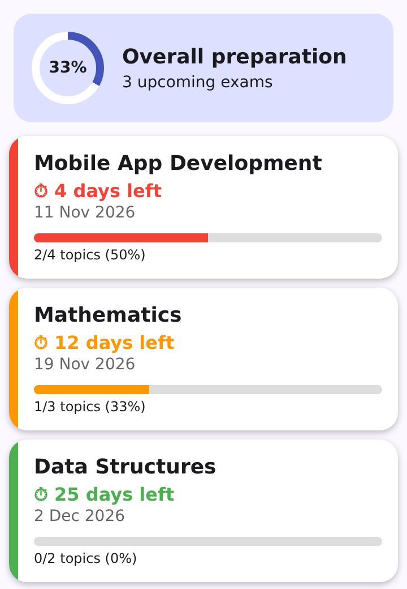
</p>

**Code:** [`lib/widgets/subject_card.dart`](lib/widgets/subject_card.dart)

---

## 🧪 Experiment 3 – Responsive UI

**Aim:** Create a layout that adapts to different screen sizes using `MediaQuery`.

**What I did in the project**
- If screen width < 600 px → `ListView.builder` (phone)
- Otherwise → `GridView` with `SliverGridDelegateWithMaxCrossAxisExtent` (tablet / landscape / web)

| Phone (List) | Wide screen (Grid) |
|---|---|
|  | 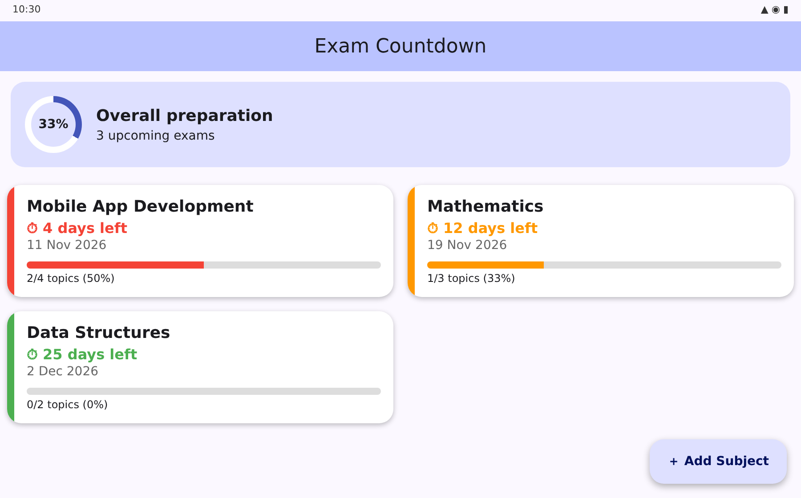 |

**Code:** [`lib/screens/home_screen.dart`](lib/screens/home_screen.dart)

---

## 🧪 Experiment 3 (b) – Forms, Validation & SnackBar

**Aim:** Build a form with `TextFormField`, validators, date picker and show feedback.

**What I did in the project**
- Add Subject form: subject name (required), exam date (required), topics (optional, comma separated)
- Validation messages when fields are empty
- `showDatePicker` to choose the exam date
- `SnackBar` after saving successfully

| Form screen | Validation errors | Date picker | SnackBar |
|---|---|---|---|
| 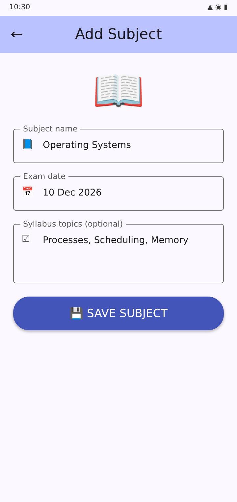 | 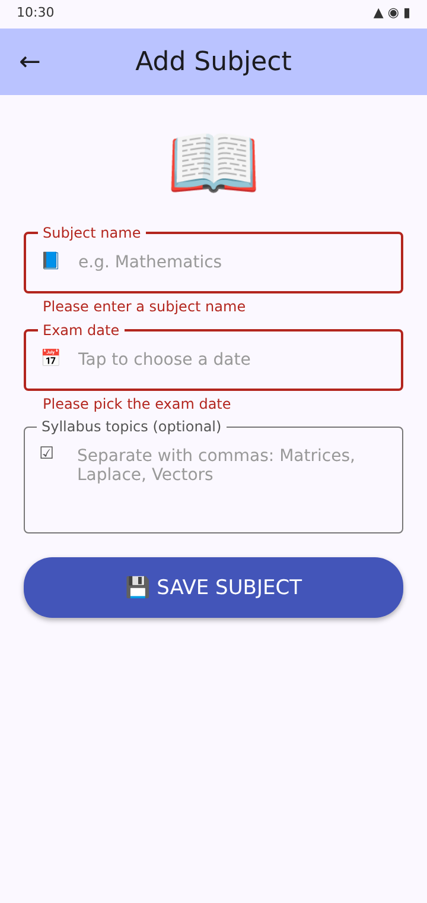 | 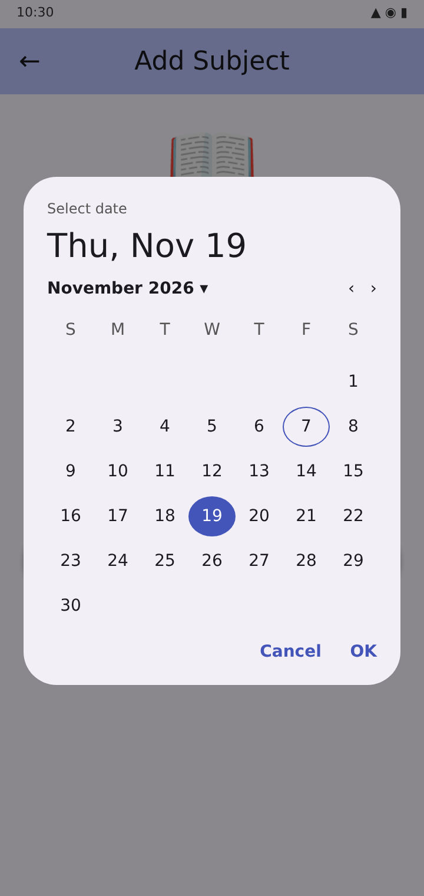 | 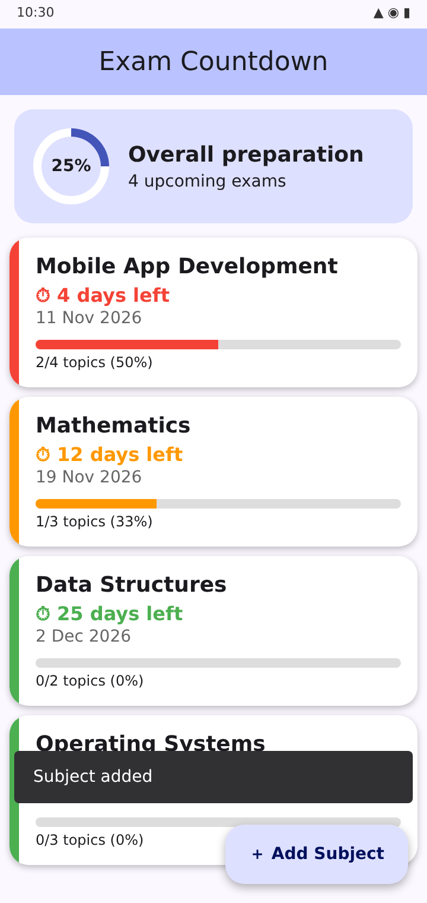 |

**Code:** [`lib/screens/add_subject_screen.dart`](lib/screens/add_subject_screen.dart)

---

## 🧪 Experiment 4 – Navigation & Named Routes

**Aim:** Move between screens using `Navigator.push`, `Navigator.pop` and named routes, and pass data.

**What I did in the project**
- Routes: `/` (Home), `/add` (Add Subject), `/detail` (Subject Detail)
- Floating Action Button opens the Add Subject screen
- Tapping a card opens the Detail screen and passes the subject **id** as a route argument
- Back button / `Navigator.pop` returns to Home

| Home | Add Subject | Subject Detail |
|---|---|---|
| 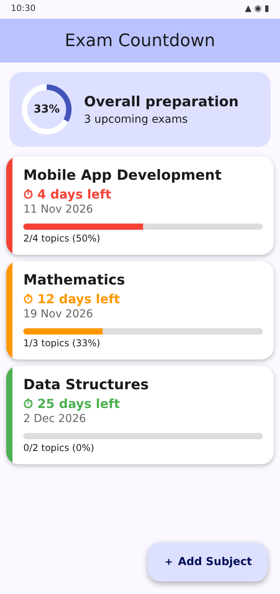 | 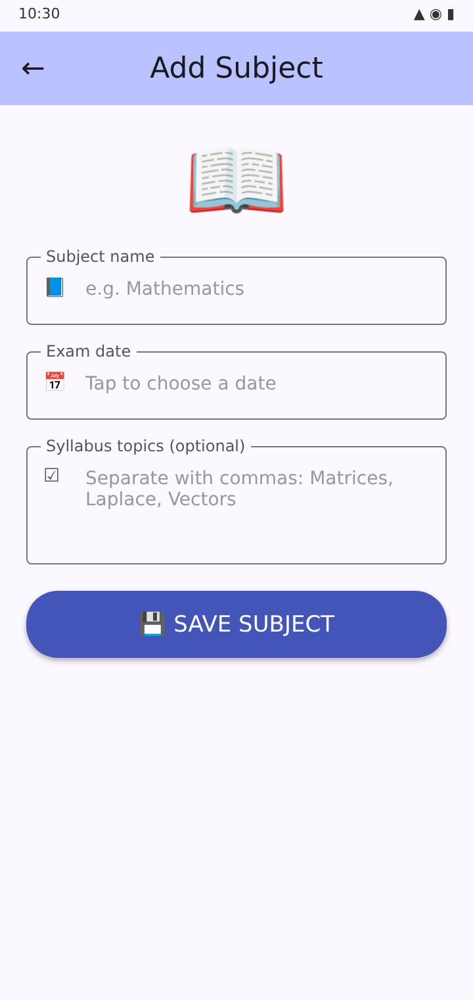 | 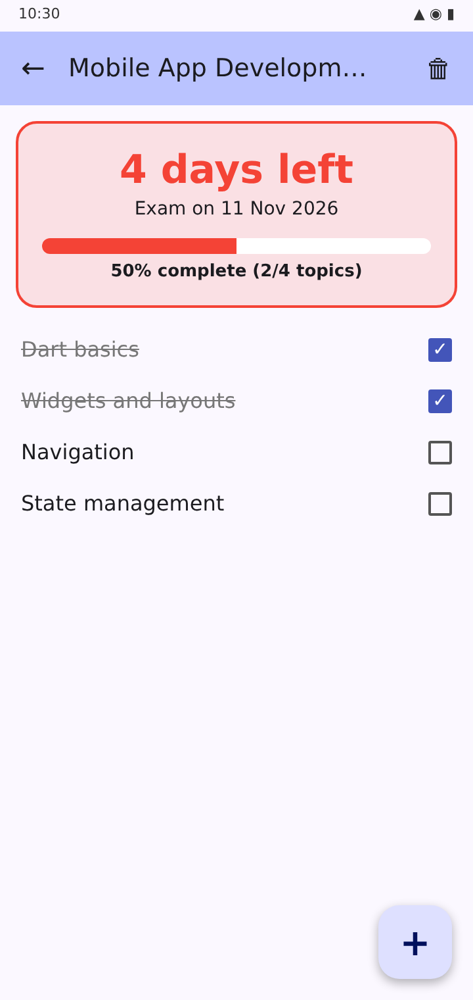 |

**Code:** [`lib/main.dart`](lib/main.dart) · [`lib/screens/subject_detail_screen.dart`](lib/screens/subject_detail_screen.dart)

---

## 🧪 Experiment 5 – State Management (setState & Provider)

**Aim:** Manage app state with `setState` and the `Provider` package.

**What I did in the project**
- `setState` – used for the date picker selection in the form
- `PlannerProvider` (`ChangeNotifier`) – stores all subjects and topics
- `ChangeNotifierProvider` wraps the app in `main.dart`
- `context.watch` rebuilds the UI when a topic is ticked; `context.read` calls methods like `addSubject`, `toggleTopic`, `deleteSubject`
- Progress % updates instantly on both Detail and Home screens

| Tick topics → progress updates | Home progress updated | Swipe to delete topic |
|---|---|---|
| 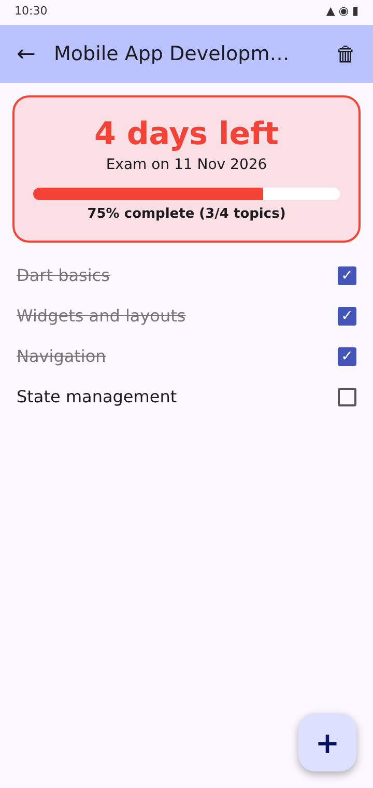 | 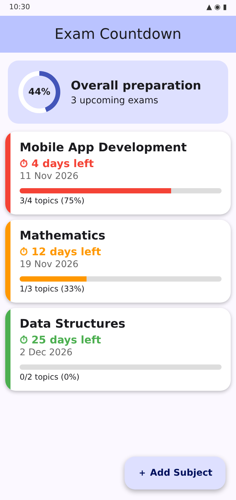 | 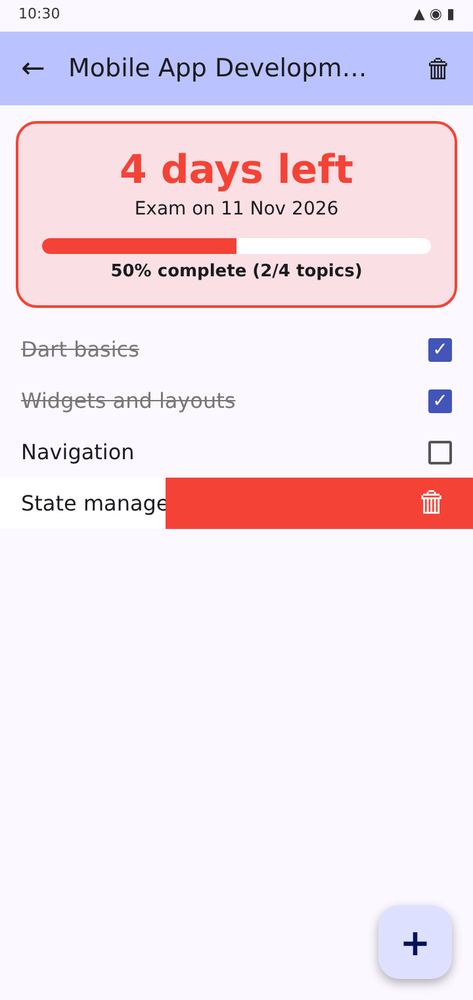 |

**Code:** [`lib/providers/planner_provider.dart`](lib/providers/planner_provider.dart) · [`lib/models/subject.dart`](lib/models/subject.dart)

---

## 📁 Project Structure

```
exam_planner/
├── lib/
│   ├── main.dart                     # App entry, routes, Provider setup
│   ├── models/
│   │   └── subject.dart              # Subject & Topic models
│   ├── providers/
│   │   └── planner_provider.dart     # State management (ChangeNotifier)
│   ├── screens/
│   │   ├── home_screen.dart          # Responsive list/grid + summary
│   │   ├── add_subject_screen.dart   # Form with validation
│   │   └── subject_detail_screen.dart# Countdown + syllabus checklist
│   └── widgets/
│       └── subject_card.dart         # Colour-coded subject card
├── screenshots/                      # Images used in this README
├── pubspec.yaml
└── README.md
```

---

## ▶️ How to Run

```bash
git clone https://github.com/<your-username>/exam_planner.git
cd exam_planner
flutter pub get
flutter devices
flutter run
```

**On a phone:** enable *Developer options → USB debugging*, connect via USB, then run `flutter run`.

---

## 🛠️ Tech Stack

| Tool | Purpose |
|---|---|
| Flutter / Dart | UI framework & language |
| Material 3 | Design system |
| Provider | State management |
| shared_preferences | Local storage |

---

## 👩‍🎓 Author

**Name:** Mounika Baddula
**Roll No:** 24AG1A05W4
**College:** ACE Engineering College
**Subject:** UI Flutter
